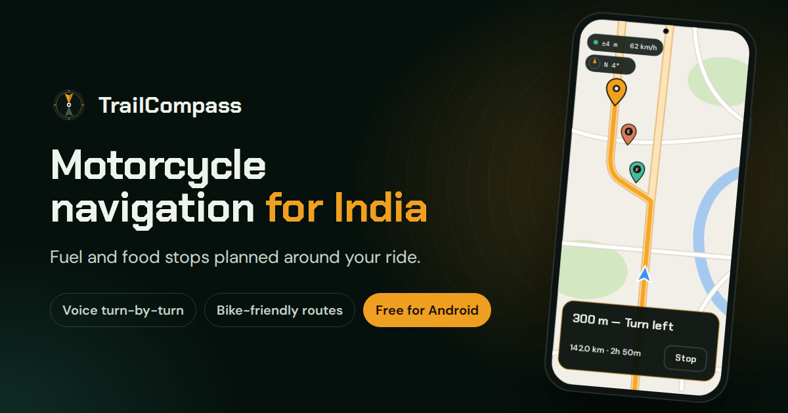

  

<h1 align="center">TrailCompass</h1>

  <strong>Motorcycle navigation that plans your fuel and food stops.</strong> 
  Free for Android. Built for Indian roads.

  
  
  

  <a href="https://praneth2580.github.io/TrailCompass/"><strong>Get TrailCompass for Android</strong></a>
  &nbsp;·&nbsp;
  <a href="https://praneth2580.github.io/TrailCompass/#install">How to install</a>

---

TrailCompass keeps you on roads bikes are allowed on, speaks every turn into your helmet, and suggests petrol pumps and meal stops along the way. Plan your ride while you have a connection. Turn-by-turn and voice prompts keep going when the signal drops.

## Made for long days in the saddle

- **Routes for bikes.** Choose Fastest, Shortest or Less traffic, and compare up to three routes. Expressways closed to two-wheelers are avoided unless you allow them.
- **Voice turn-by-turn.** Spoken prompts, timed to your speed, go straight into your helmet headset. Miss a turn and the route recalculates on its own.
- **Keeps going on weak signal.** Routes are calculated on your phone. Once a route is planned, turn-by-turn, voice prompts and stop suggestions work without a connection.
- **Built for the handlebar.** A full-screen ride view while you're moving, a screen that stays on, and large touch targets that are easy to hit. Tap the compass for zen mode: just the map, your route and a big compass.
- **Plans while you do other things.** Send a long route plan to the background and follow it in a notification, with Pause and Stop. Set downloads to Wi-Fi only to save mobile data.
- **Save and share rides.** Keep trips in your library and open them later without planning again. Share a route as a file with your riding group.
- **Always up to date.** TrailCompass tells you when a new version is out and installs it from inside the app. Fuel and food data refreshes every month on its own.

## Stops that fit your ride

**Fuel by tank range.** Tell TrailCompass how far a full tank takes you. It picks pumps near your route in the last stretch of each tank, then plans the next leg from the pump you chose. If a stretch has no pump, it tells you to fill up earlier.

**Food by time of day.** Set when you leave. It finds breakfast, lunch or dinner where you'll be at that hour.

About **55,000 fuel stations** and **138,000 places to eat** across India are built into the app, so suggestions work offline. The data is refreshed every month.

## How it works

1. **Plan.** Search for your destination or drop a pin on the map. Add fuel, food or your own stops in the order you want them.
2. **Preview.** Compare up to three routes by distance and time. Save the one you like, or share it with the group.
3. **Ride.** Tap Start and follow the voice prompts. Go off route and it recalculates, keeping the stops you haven't reached yet.

## Install in a minute

1. On your Android phone, open the [TrailCompass website](https://praneth2580.github.io/TrailCompass/) and tap **Download for Android** (about 10 MB).
2. Open the downloaded file. If Android asks, let your browser install apps (*Install unknown apps*).
3. Tap **Install**, open TrailCompass and allow location access.

TrailCompass isn't on Google Play yet, so Android may warn you about installing an app from outside it. After this first install, new versions come through the app itself: it offers each one when it's released, or you can check from the **Offline** tab.

## Questions riders ask

<strong>Is TrailCompass free?</strong>

Yes. There's no account to create and no ads.

<strong>Does it work offline?</strong>

Partly. Plan your route while you have a connection: the roads are saved on your phone, and turn-by-turn, voice prompts and fuel and food suggestions then work without signal. The background map needs a connection to load areas you haven't viewed.

<strong>Which phones does it run on?</strong>

Android 6.0 or newer. There is no iPhone version.

<strong>Where does the map and place data come from?</strong>

Maps, roads and search come from OpenStreetMap, through OpenFreeMap, Overpass and Nominatim. Fuel stations and places to eat come from the Overture Maps Foundation and OpenStreetMap.

<strong>Does it collect my data?</strong>

There's no account and no analytics. To show the map and plan routes, the app downloads data for the areas you use from the open-data services above.

## Ride safe

TrailCompass is not a certified navigation or safety system. GPS, compass readings and map data can be wrong or unavailable. Keep a backup way to navigate, follow the road rules, and set your route before you ride: never operate the phone while riding.

## Credits

Map data © [OpenStreetMap contributors](https://www.openstreetmap.org/copyright) · map tiles by [OpenFreeMap](https://openfreemap.org) · places from the [Overture Maps Foundation](https://overturemaps.org) ([sources and licences](public/assets/poi/README.md)) · search by [Nominatim](https://nominatim.org) · roads through the [Overpass API](https://overpass-api.de).

## For developers

Building TrailCompass or helping out? Start with **[DEVELOPMENT.md](DEVELOPMENT.md)**.
